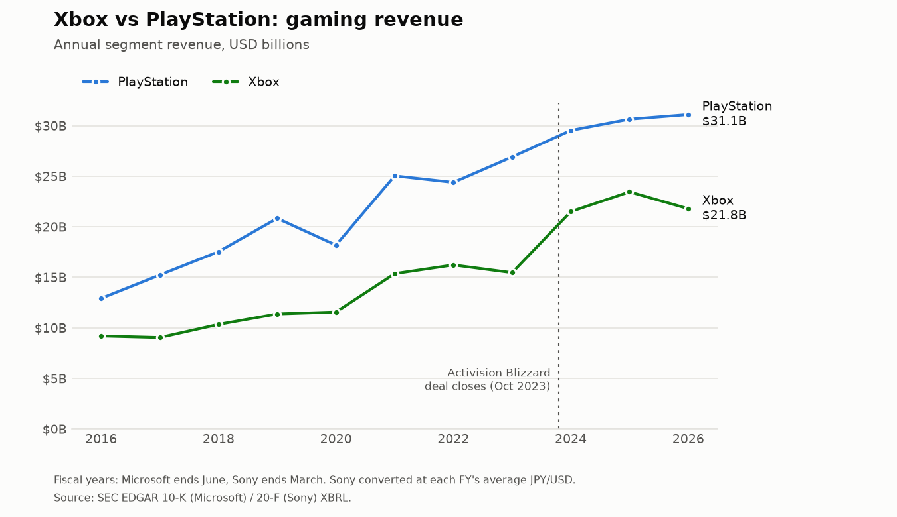
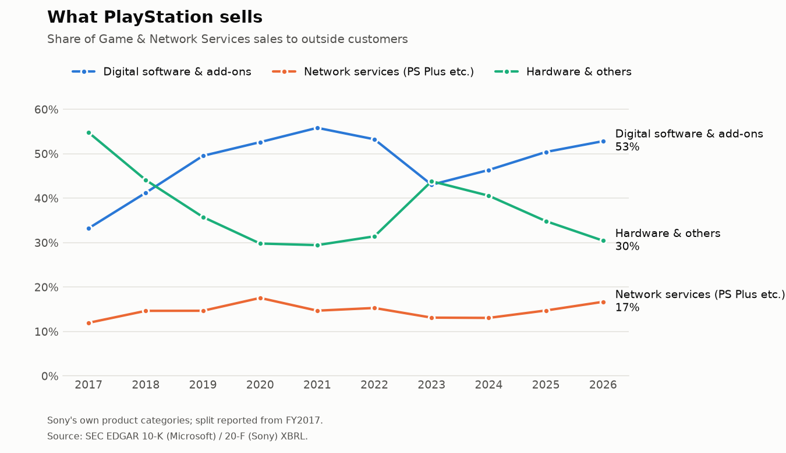
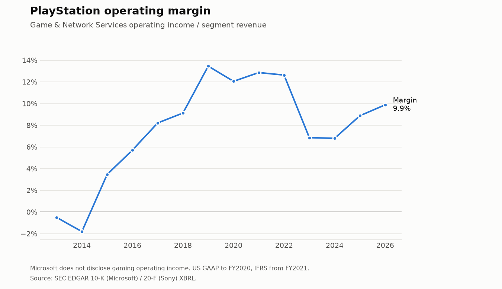

# Console War Financials: Xbox vs PlayStation, from SEC filings

An automated pipeline that pulls Microsoft's 10-K and Sony's 20-F filings from SEC EDGAR, isolates each company's gaming segment, puts both on the same footing (currency and fiscal year), checks the data, and produces a finance-style **Excel variance report** and charts. It refreshes itself monthly with GitHub Actions.



## Three findings

1. **The weak yen hid PlayStation's growth.** In FY2024, PlayStation's segment revenue grew **+17.1% in yen** but only **+9.8% in dollars**. In FY2025 the gap was +9.4% vs +3.8%. Comparing it to Xbox in dollars without that context understates how PlayStation actually performed.
2. **Activision closed most of the gap, but only for a while.** Xbox's share of combined Xbox + PlayStation revenue went from **36.5% (FY2023) to 43.4% (FY2025)**. Xbox revenue jumped **+39.0%** in FY2024, the year the deal closed (about 8.5 months included). In FY2026 Xbox fell **-7.1%** while PlayStation still grew (+1.5% in USD).
3. **PlayStation became a digital business, and it shows in profit.**
   - Digital software & add-ons rose from **33% to 53%** of PlayStation's outside sales (FY2017 to FY2026), while hardware & others fell from **55% to 30%**.
   - In FY2026, hardware & others dropped ¥191.6bn, yet operating income still rose **+11.7%**.
   - The margin recovered from **6.8% (FY2024) to 9.9%**.

| What PlayStation sells | PlayStation operating margin |
|---|---|
|  |  |

## What's in the Excel report

`reports/console_war_financials.xlsx` contains:
- **Summary:** head-to-head revenue in USD and each side's share.
- **Xbox** and **PlayStation:** value, prior year, YoY $ and %, with red/green highlighting and an auto-written commentary line per year.
  - Example: *"G&NS revenue +17.1% YoY in yen (weaker yen: +9.8% in USD); biggest mover digital software & add-ons (+¥411.5bn); operating income +16.1%."*
- **Restatements:** every number a later filing changed.
- **Sources:** every value with its XBRL concept, accounting basis, accession number, and a link to the filing on EDGAR.

## How it works

1. **Find filings.** Pulls each company's SEC submissions history, including the older pages, and keeps the annual 10-K or 20-F reports, skipping amendments.
2. **Parse XBRL.** Reads each filing's XBRL file (the structured data version of the financial statements), including the *dimensional* facts. Segment numbers only exist there; the SEC's simple company-facts API returns only company-wide totals.
3. **Map tags to metrics** with [`cwf/tag_map.yaml`](cwf/tag_map.yaml). The map was built by enumerating every gaming-segment fact across all filings (`python -m cwf.explore`). The labels change over time:
   - Microsoft renamed its member from `GamingMember` to `XBOXMember` (FY2026 10-K).
   - Sony moved from **US GAAP to IFRS** in FY2021. The concepts changed from `Revenues`/`OperatingIncomeLoss` to `Revenue`/`ProfitLossFromOperatingActivities`, and the axis names changed too.
   - Each rule requires an exact dimension count, so a segment total is never double counted against its external-sales version.
4. **Normalize.**
   - Sony's yen are converted at each fiscal year's **average** USD/JPY rate (Federal Reserve series DEXJPUS).
   - Growth is shown in both yen and USD.
   - Years are labeled by the year the period *ends*. Sony itself calls the year ending March 2026 "FY2025"; here it is FY2026, so it lines up with Microsoft's FY2026 (ending June 2026).
5. **Model in DuckDB** ([`sql/`](sql)).
   - When a later filing restates a year, the latest filing wins, and the superseded value goes to a restatement log.
   - The only restatement found: Sony's FY2021 operating income, ¥342.2bn under US GAAP → ¥341.7bn under IFRS.
6. **Check the data. Any failure stops the run.**
   - Sony's three product buckets must sum to its external revenue. They match to 100.00% every year.
   - No missing years in any series.
   - No filing may report two different values for the same number.
   - Every number has a USD value.
7. **Report.** The Excel workbook (openpyxl) and charts (matplotlib, colorblind-checked colors, direct labels).

## Limitations

- **Microsoft does not disclose gaming operating income**, or a hardware vs content split in its structured data, so margin and mix are PlayStation-only.
- **Different fiscal years.** Microsoft's ends in June and Sony's in March, so "FY2026" is a 3-month offset. Results are annual only. Sony's quarterly figures are not in XBRL.
- **Sony's product split starts at FY2017.** Before that, Sony's "Network" category mixed digital software and network services, so it isn't comparable.
- **Scope differs.** Sony's segment total includes sales to other Sony segments (2–5% in FY2016–FY2026). Xbox's line is Microsoft's reported gaming revenue.
- This is an analysis of reported segment results, not investment advice.

## Run it

```bash
pip install -r requirements.txt
cp .env.example .env          # set SEC_USER_AGENT="Your Name you@example.com" (SEC fair-access rule)
python -m cwf.pipeline        # downloads ~50 files politely (<= 5 requests/s), caches them in data/cache/
python -m cwf.pipeline --offline   # rebuild from cache only
python -m pytest -q           # 44 tests, all offline
```

Stack: Python, requests, DuckDB (SQL models), openpyxl, matplotlib, pytest, GitHub Actions. Data: SEC EDGAR XBRL and FRED. No API keys.
